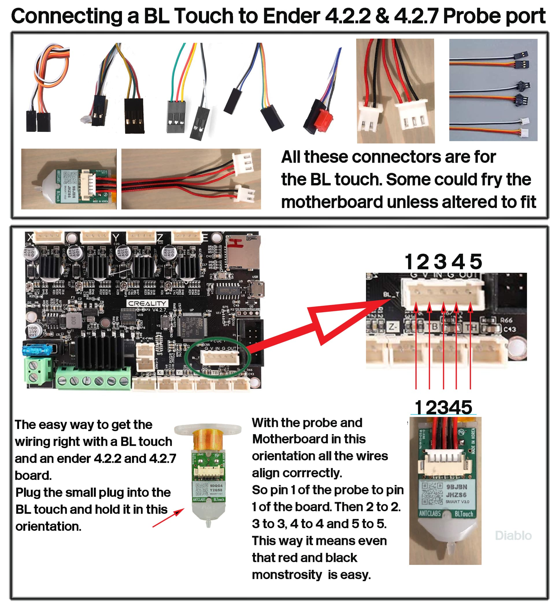
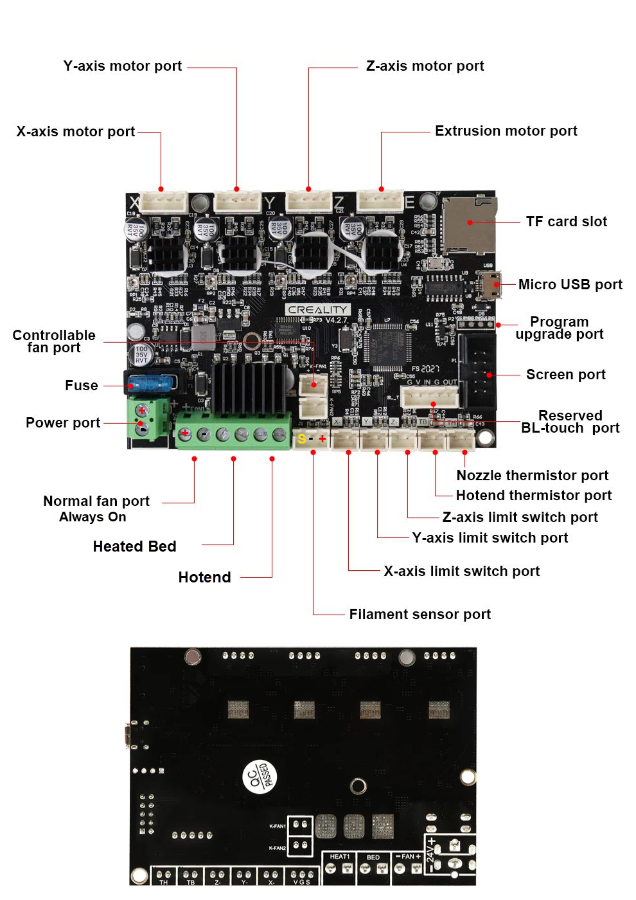
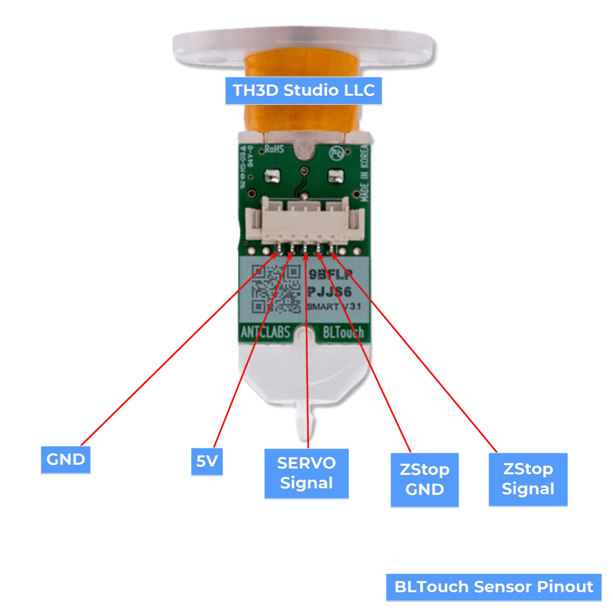
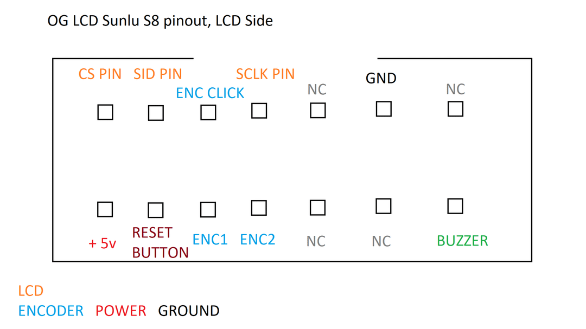
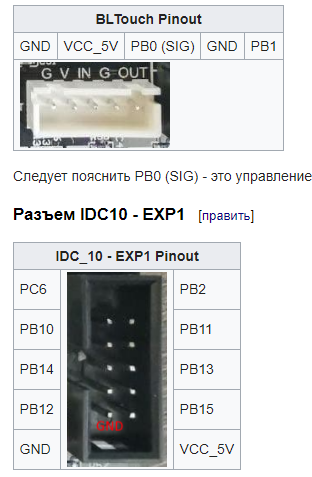

Here is the compact, all-in-one blueprint for your Sunlu S8 mod with a Creality 4.2.2 **(HR4988 "C" chip) motherboard**, **12864 original display**, and **BLTouch**:

[](images/bltouch-connection.jpeg)


[](https://tickets.digitalforgesystems.com/download/0c944f5f1c2a03686fd3a2516a7b20667209ac778ddea7ad1ef749d5a53ec7c40621d0e5f2e352ec?t=5f6e4ec56cc779991c8dac350b981f4d)

🛠️ Hardware Setup

* **Display:** Requires custom cross-over wiring using individual DuPont jumpers. See the detailed wiring map below.  
* **Dual Z-Motors:** Plug both Z-axis motors into a **parallel Y-splitter cable**, then plug the splitter into the single Z-motor port on the board.  
* **BLTouch:** Plug the 5-pin cable directly into the board's dedicated 5-pin BLTouch port. Disconnect the original mechanical Z-endstop switch.

---

💻 Firmware Master Configuration (Configuration.h)

Compile using **Marlin 2.1.x** with the following specific settings:

cpp

// Board & Serial Definitions

\#define SERIAL\_PORT          0

\#define SERIAL\_PORT\_2       \-1

\#define MOTHERBOARD         BOARD\_CREALITY\_V422

// Drivers (The "C" on your SD slot means HR4988 drivers)
//
// Marlin has no HR4988 driver type. HR4988 is driven exactly like A4988,
// so use A4988 here. Writing HR4988 will fail Marlin's sanity check.

\#define X\_DRIVER\_TYPE  A4988

\#define Y\_DRIVER\_TYPE  A4988

\#define Z\_DRIVER\_TYPE  A4988

\#define E0\_DRIVER\_TYPE A4988

// Sunlu S8 Physical Dimensions

\#define X\_BED\_SIZE 310

\#define Y\_BED\_SIZE 310

\#define Z\_MAX\_POS  400

// Stepper Inversion (Invert if axes move backward during testing)

\#define INVERT\_X\_DIR true

\#define INVERT\_Y\_DIR true

\#define INVERT\_Z\_DIR false

\#define INVERT\_E0\_DIR true

// Screen Activation (Original 12864 Display)
//
// The Creality V4/V422 pins file only defines LCD_PINS_* when
// CR10_STOCKDISPLAY is selected. The Sunlu S8 panel is a standard
// 12864 ST7920 display, so use the board's native mapping instead of
// REPRAP_DISCOUNT_FULL_GRAPHIC_SMART_CONTROLLER.
//
// Do NOT add LCD_PINS_D4 / LCD_PINS_EN / LCD_PINS_RS to Configuration.h:
// those pins come from Marlin/src/pins/stm32f1/pins_CREALITY_V4.h.
\#define CR10\_STOCKDISPLAY
\#if ENABLED(CR10\_STOCKDISPLAY)
  \#define RET6\_12864\_LCD  // 512K STM32F103RE board (use VET6_12864_LCD for 256K)
\#endif

// BLTouch & Bed Leveling Config

\#define BLTOUCH

\#define Z\_MIN\_PROBE\_PIN PB1

\#define USE\_PROBE\_FOR\_Z\_HOMING

\#define Z\_SAFE\_HOMING

\#define AUTO\_BED\_LEVELING\_BILINEAR

// NOTE: When using the 5-pin BLTouch header, Z\_MIN\_PROBE\_USES\_Z\_MIN\_ENDSTOP\_PIN should be commented out 

// Your Specific BLTouch Offsets & Margins

\#define NOZZLE\_TO\_PROBE\_OFFSET { \-44, \-7, 0 }

\#define PROBING\_MARGIN 15

// Filament Runout Sensor
\#define FILAMENT\_RUNOUT\_SENSOR
\#define FILAMENT\_RUNOUT\_SCRIPT "M600"
\#define FIL\_RUNOUT\_STATE LOW

// 3Dman Extruder E-Steps (3:1 Gear Reduction)
\#define DEFAULT\_AXIS\_STEPS\_PER\_UNIT { 80, 80, 400, 395 }

Use code with caution.

---

💻 Firmware Advanced Configuration (Configuration_adv.h)

// Filament Runout Sensor Pull-up
\#define FIL\_RUNOUT\_PULLUP

---

## 🔧 3Dman Extruder E-Steps Configuration

**Important:** The 3Dman extruder uses a **3:1 gear reduction ratio**, which means the stepper motor needs to turn three times as much to push the same amount of plastic compared to a direct-drive extruder.

### E-Steps Comparison

| Extruder Type | E-Steps (steps/mm) |
| --- | --- |
| Stock Sunlu S8 | ~93–98 |
| 3Dman Extruder | ~385–410 |

### Recommended Firmware Setting

Add this line to your `Configuration.h`:

```cpp
#define DEFAULT_AXIS_STEPS_PER_UNIT { 80, 80, 400, 395 }
```

Where the four values correspond to X, Y, Z, and E0 respectively.

### Calibration

After flashing the firmware with the new e-steps value, you should calibrate the extruder for maximum accuracy:

1. Mark your filament 100mm from the extruder entry
2. Command the printer to extrude 100mm (via LCD or G-code: `G1 E100 F100`)
3. Measure how much filament was actually consumed
4. Calculate the corrected e-steps:

```
Corrected E-Steps = (Requested Distance / Actual Distance) × Current E-Steps
```

5. Update the e-steps value in the firmware, recompile, and reflash

---

🚀 First Boot & Safety Test

1. **Flash:** Put the compiled firmware-xxxxx.bin onto a blank, FAT32-formatted SD card (\<8GB), insert it while powered off, and boot up.  
2. **The Finger-Test:** Keep your hand on the physical power switch and select Auto Home.  
3. **Trigger Probe:** When the head moves to the center and the Z-axis begins moving *down*, **tap the BLTouch pin with your finger**.  
   * **If it stops:** Success. Proceed to calibrate your final Z-offset via the screen menu.  
   * **If it keeps moving down:** Shut off power immediately. Your probe signals are not reaching the board correctly.

Would you like the exact **PlatformIO environment string** for your platformio.ini file to ensure it compiles without errors for this specific 4.2.2 motherboard?

## BLtouch wiring

[](https://tickets.digitalforgesystems.com/download/24c6d4a6059d54956647794d634ffa6250310257e146e78c892b6381c221b5754ce919cb8db7163e?t=97c58d9a9ca2b138bd4cad8178589725)

## **Display**

⚠️ **IMPORTANT:** Your Sunlu S8 screen has a **14-pin EXP1 connector**, while the Creality 4.2.2 board has a **10-pin EXP1 connector**. You will need to create a custom wiring harness to map the 14 pins to the 10 pins on the board.

When wiring the **Sunlu S8 original 12864 screen** manually to a **Creality 4.2.2 motherboard**, you are mapping the screen's 14-pin EXP1 interface to the board's 10-pin EXP1 interface with a custom cross-over wiring configuration.

The original screen relies on an **ST7920 controller chip**, which dictates how the screen handles serial data. To build your own custom wiring harness or cross-over cable, use the comprehensive maps below. \[[1](https://reprap.org/wiki/RepRapDiscount_Full_Graphic_Smart_Controller), [2](https://docs.duet3d.com/User_manual/Connecting_hardware/Display_12864)\]

---

🗺️ Pin Numbering Reference

**Sunlu S8 14-Pin Display Connector (EXP1):**

The Sunlu S8 display has a [14-pin connector](https://raw.githubusercontent.com/dml-tech/marlin-sunlu_s8/master/EXP1%20pinout.txt) (7 pins × 2 rows). Looking at the connector with the **key notch facing UP**, the pins are arranged as follows:

[](https://preview.redd.it/sunlu-s8-skr-1-4-turbo-og-lcd-v0-zm6pc9gx5e5b1.png?width=1080&crop=smart&auto=webp&s=f1cafedf66a4a7e1649cefa7b456209c2c6e898e)

```
               [ NOTCH ]

  (2)  (4)  (6)  (8)  (10) (12) (14)

  (1)  (3)  (5)  (7)  (9)  (11) (13)
```

**Sunlu Display Pinout:**
- Pin 1: VCC (+5V)
- Pin 2: LCD RS (Chip Select)
- Pin 3: RESET
- Pin 4: LCD EN (Enable/Clock)
- Pin 5: BTN EN2 (Encoder B)
- Pin 6: BTN ENC (Encoder Click)
- Pin 7: BTN EN1 (Encoder A)
- Pin 8: LCD D4 (SID/MOSI)
- Pin 9: NC (Not Connected)
- Pin 10: NC (Not Connected)
- Pin 11: NC (Not Connected)
- Pin 12: GND
- Pin 13: BEEPER
- Pin 14: NC (Not Connected)

**Creality 4.2.2 10-Pin EXP1 Connector:**

The Creality board has a 10-pin connector (5 pins × 2 rows). The assignment below matches Marlin's [`pins_CREALITY_V4.h`](https://github.com/MarlinFirmware/Marlin/blob/bugfix-2.1.x/Marlin/src/pins/stm32f1/pins_CREALITY_V4.h) when `RET6_12864_LCD` is selected. Looking at the connector with the **key notch facing UP**, the pins are arranged as follows:

```
              Plastic Notch
                 [ ___ ]
      +-----------     -----------+
      |  (2)  (4)  (6)  (8)  (10) |
      |  (1)  (3)  (5)  (7)  (9)  |
      +---------------------------+

```
- EXP1_1: PC6 (Beeper)
- EXP1_2: PB2 (Encoder button)
- EXP1_3: PB10 (Encoder A)
- EXP1_4: PB11 (Not used by this build)
- EXP1_5: PB14 (Encoder B)
- EXP1_6: PB13 (SPI clock / SCLK / LCD EN)
- EXP1_7: PB12 (LCD chip select / RS / CS)
- EXP1_8: PB15 (SPI data / SID / MOSI / LCD D4)
- EXP1_9: GND
- EXP1_10: +5V

> **Pin 1 orientation:** Pin 1 is the end marked with a small triangle or `1` on the board. If your board marks the opposite end, identify the wires by the MCU pin names above, not by the printed pin number. Reversing +5V and GND can destroy the display or the board.

[](https://user-images.githubusercontent.com/8165290/118611412-3ed59080-b7d6-11eb-8a78-9a87a98087e9.png)


| Pin Number | MCU Pin Name | Main Function / Notes |
|------------|--------------|-----------------------|
| 1 | PC6 | Beeper |
| 2 | PB2 | Encoder button (click) |
| 3 | PB10 | Encoder A |
| 4 | PB11 | Not used by this build (UART3 RX) |
| 5 | PB14 | Encoder B |
| 6 | PB13 | SPI clock (SCLK / LCD EN) |
| 7 | PB12 | LCD chip select (RS / CS) |
| 8 | PB15 | SPI data (SID / MOSI / LCD D4) |
| 9 | GND | Ground Connection |
| 10 | 5V | +5V Power Supply |


Step-by-Step Custom Wiring Guide

1. Obtain Dupont Jumpers: Use 9 individual female-to-female Dupont jumper wires to connect between the two connectors.
2. Orienting the Plugs:
	• On both the Creality board and your screen PCB, look closely for a small "1" printed next to the corner of the header shroud. This marks Pin 1.
	• If there are no numbers, look at the plastic shroud's notch cutout. When looking directly into the socket with the plastic cutout notch pointing UP:

---

🔌 Manual Cross-Over Wiring Map

To make the display, the clickable encoder knob, and the speaker work perfectly, wire individual DuPont lines directly from the **Creality EXP1 port** to the **Sunlu Display EXP1 port** exactly as follows:


| Creality 4.2.2 Mainboard Pin | Function | Map to Sunlu Display (14-pin) EXP1 Pin | Notes / Hardware Hookup |
| --- | --- | --- | --- |
| EXP1_10 | +5V Power | Pin 1 (VCC) | Logic Supply Power |
| EXP1_9 | GND | Pin 12 (GND) | Ground Connection |
| EXP1_1 | Beeper (PC6) | Pin 13 (BEEPER) | Speaker/Buzzer |
| EXP1_2 | Click Button (PB2) | Pin 6 (BTN ENC) | Push-switch click pin |
| EXP1_8 | SID / MOSI (PB15) | Pin 8 (LCD D4) | SPI Data Line |
| EXP1_7 | LCD_CS / RS (PB12) | Pin 2 (LCD RS) | SPI Chip Select |
| EXP1_6 | SCLK / SCK (PB13) | Pin 4 (LCD EN) | SPI Clock Line |
| EXP1_3 | Encoder A (PB10) | Pin 7 (BTN EN1) | Dial rotation directional signal |
| EXP1_5 | Encoder B (PB14) | Pin 5 (BTN EN2) | Dial rotation directional signal |
| EXP1_4 | Unused (PB11) | — (leave Pin 3 RESET disconnected) | Not used by this build |

**Note:** The following Sunlu display pins are **not connected** and should be left unconnected:
- Pin 3 (RESET) — the ST7920 resets on power-up; this build has no LCD reset pin on EXP1
- Pin 9 (NC)
- Pin 10 (NC)
- Pin 11 (NC)
- Pin 14 (NC)


---

## 🎯 Runout Sensor Installation

To connect your 2-wire Sunlu S8 sensor to the 3-pin FIL-DET port using Marlin, you need to ensure the hardware wires align correctly and configure the firmware to activate the internal pull-up resistor.

### Step 1: Wire Alignment (Hardware)

Look closely at the white 3-pin FIL-DET port (labeled J1) on your Creality 4.2.2 motherboard. You must position your 2 wires so they occupy the Signal and Ground positions, leaving the voltage pin empty:

- **Pin 1: Signal (S)** ➡️ Connect Wire A here (Top pin, closest to the center of the board)
- **Pin 2: Ground (G)** ➡️ Connect Wire B here (Middle pin)
- **Pin 3: 5V Power (V)** ➡️ LEAVE BLANK (Bottom pin, closest to the edge of the board)

**Tip:** If your 2-wire cable uses a 2-pin connector housing, it will not natively fit securely into the 3-pin port. It is best to slide the metal pins out and insert them into a 3-pin JST-XH housing, or carefully plug the 2-pin connector onto the top two pins (S and G).

### Step 2: Configure Marlin Firmware

Open your Marlin source code in your editor (such as VS Code with PlatformIO) and modify the configuration files as follows:

**In `Configuration.h`:**

Search for `#define FILAMENT_RUNOUT_SENSOR` and uncomment it by removing the two slashes `//`:

```cpp
#define FILAMENT_RUNOUT_SENSOR
```

Set the script/command to execute when filament runs out (usually `M600` for a filament change):

```cpp
#define FILAMENT_RUNOUT_SCRIPT "M600"
```

Set the sensor logic state. For a standard 2-wire microswitch wired to Signal and Ground, start with LOW (this means the circuit connects to ground when filament is present):

```cpp
#define FIL_RUNOUT_STATE LOW
```

**In `Configuration_adv.h`:**

Because your sensor only has 2 wires, it does not power itself. It relies entirely on the motherboard to detect if the circuit is open or closed. You must enable the internal pull-up resistor, or the board will read random electrical noise and falsely trigger.

Search for `FILAMENT_RUNOUT_SENSOR_LEVELS` or pull-up configurations. Ensure this line is uncommented:

```cpp
#define FIL_RUNOUT_PULLUP
```

(If your version of Marlin doesn't have `FIL_RUNOUT_PULLUP`, ensure general pull-ups are active or that `#define ENDSTOPPULLUPS` is enabled).

### Step 3: Test and Troubleshoot

Compile your code, flash it to your Creality 4.2.2 board, and test the functionality:

- Insert filament and send an `M119` command via a terminal (like OctoPrint or Pronterface) to check endstop states
- Look for the `filament` state. It should say `open` or `not triggered`
- Pull the filament out and send `M119` again. It should change to `TRIGGERED`
- If it is reversed (says triggered when filament is inside), go back to `Configuration.h` and invert the logic state:

```cpp
#define FIL_RUNOUT_STATE HIGH
```

**Note:** Do you already have M600 (Filament Change) or Advanced Pause Park enabled in your Marlin configuration? If you aren't sure, verify your printer will actually know how to safely pause the print!

---

⚠️ Critical Physical Safety Checks

1. **Double-Check \+5V and GND:** Double-verify **Sunlu Display Pin 1 (VCC)** connects to **Creality EXP1 Pin 10 (+5V)** and **Sunlu Display Pin 12 (GND)** connects to **Creality EXP1 Pin 9 (GND)** before turning the printer on. Mixing power and ground will instantly short out the screen or the board regulator. \[[1](https://gist.github.com/neoyagami/5f431928997dbf255e84e4c937983e8e)\]
2. **Contrast Adjustment:** If you power on the printer and the screen lights up brightly but shows no text, it is likely receiving the signal but has bad contrast. Grab a small flathead screwdriver and gently adjust the **Contrast Trimpot** (usually labeled R3 or POT on the back of the Sunlu PCB) until the text pops into view. \[[1](https://docs.duet3d.com/User_manual/Connecting_hardware/Display_12864), [2](https://reprap.org/wiki/RepRapDiscount_Smart_Controller)\]

Are you **crimping custom DuPont heads** onto the wires, or are you splicing two existing ribbon cables together? If splicing, I can help you decode the cable stripe colors\!

